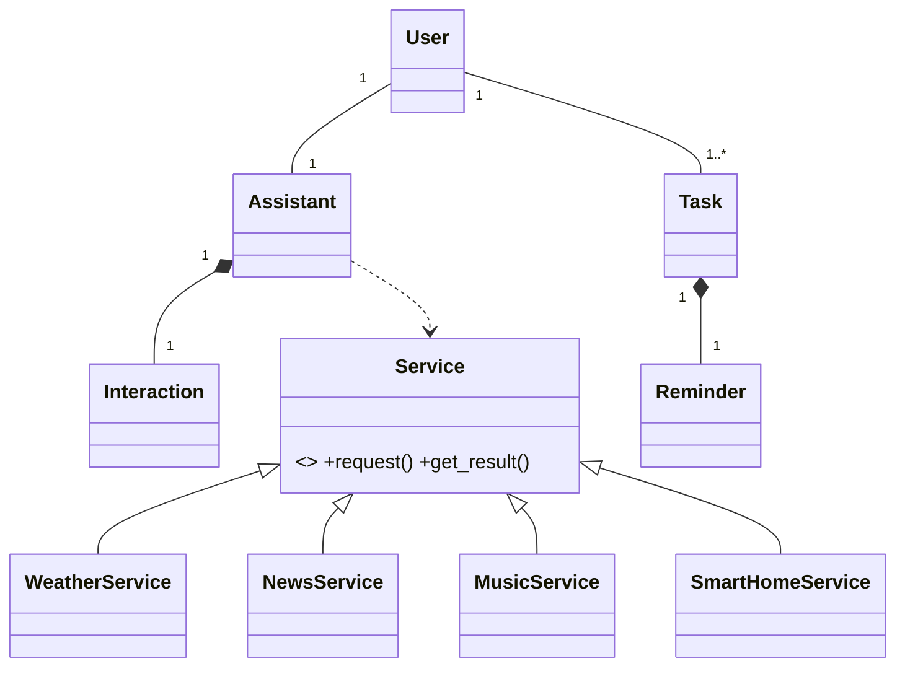

# AI-Powered Personal Assistant (OOSD / CE6014)

Poster ke Classes + Relationships ko Python mein implement kiya hai. Pure standard library, koi pip install nahi.

## Run
```bash
python main.py --demo      # scripted demo
python main.py             # interactive (tasks/history assistant_data.json mein save hote hain)
python main.py --live      # real weather (Open-Meteo, internet chahiye)
python -m unittest discover -v   # 24 tests
```
Commands: `help` type karo. Examples: `add task buy milk due tomorrow at 5pm`, `remind me to drink water at 6pm daily`,
`weather in Surat`, `news about tech`, `play jazz`, `turn on the light`, `set city to Pune`, `history`.

## UML (poster ke according)


## Poster -> Code mapping
| Poster | File |
|---|---|
| User (login, updatePreferences) | `ai_assistant/user.py` |
| Assistant (processCommand, getResponse, speak, listen) | `ai_assistant/assistant.py` |
| Interaction (store, getHistory) | `ai_assistant/interaction.py` |
| Task (create, update, delete, markComplete) | `ai_assistant/task.py` |
| Reminder (schedule, cancel) | `ai_assistant/reminder.py` |
| Service + Weather/News/Music | `ai_assistant/services/` (+ SmartHomeService for IoT feature) |

Method names Python style mein hain (`process_command` = `processCommand`).

## OOP principles kahan dikhte hain
- **Encapsulation**: sab fields private (`_x`) + properties; `User.preferences` copy return karta hai.
- **Inheritance**: Weather/News/Music/SmartHome -> `Service`.
- **Polymorphism**: `Assistant._dispatch` sirf `service.request()` / `service.get_result()` call karta hai.
- **Abstraction**: `Service` abstract hai (instantiate karoge to TypeError); `_fetch()` details chhupa deta hai.
- **Composition**: Assistant owns Interactions, Task owns Reminder.

## Naya service add karna (Open/Closed)
```python
class JokeService(Service):
    keywords = ("joke",)
    def _fetch(self, query, context): return "Why do programmers prefer dark mode? Light attracts bugs."
assistant.register_service(JokeService())   # Assistant ka code change nahi hua
```

## QA section (poster)
`tests/test_assistant.py`: Reminder alone test hota hai (bina Assistant ke), providers mock hote hain
(`test_mock_provider_failure_is_friendly`), plus unit + integration + persistence tests.

## Future scope hooks
- AI/ML: `Assistant._dispatch` ke fallback mein LLM call laga sakte ho.
- IoT: `SmartHomeService._fetch` mein MQTT/Home Assistant.
- Multi-language: `Assistant.language` + intent patterns.
- Voice: `--voice` (pyttsx3) already speak() se juda hai.
